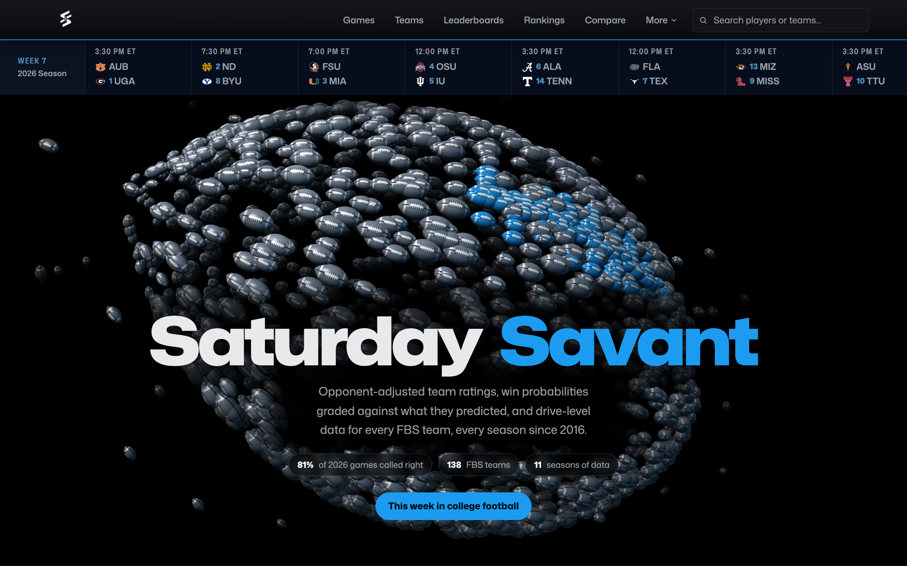
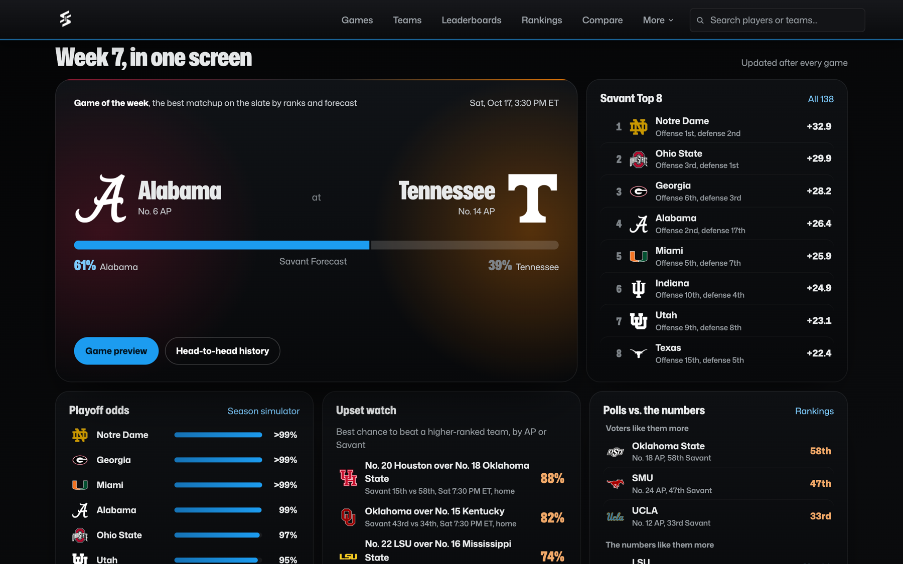
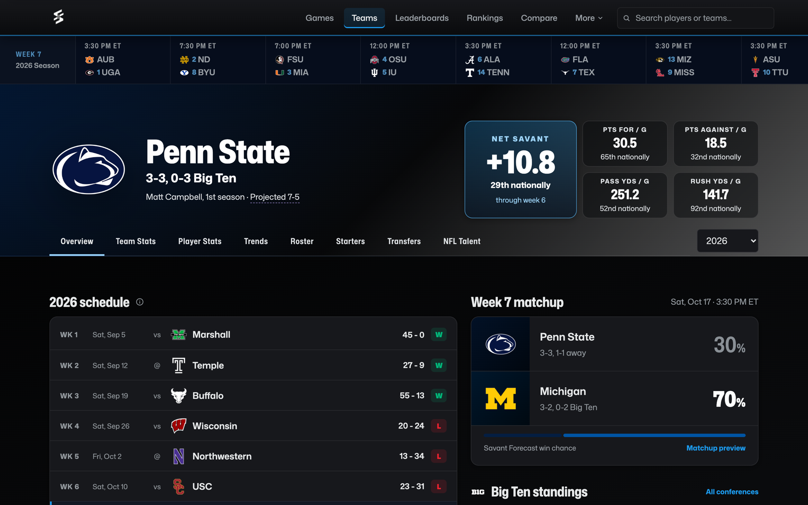

<div align="center">
  

  <h1>Saturday Savant</h1>

  <p><strong>College football, quantified.</strong><br>
  Opponent-adjusted team ratings, win probabilities graded against what they predicted, and drive-level data for every FBS team, every season since 2016.</p>

  <p>
    <a href="https://saturdaysavant.com"><strong>saturdaysavant.com</strong></a>
  </p>

  <p>
    
    
    
    
  </p>

  
</div>

---

Saturday Savant is a Baseball-Savant-inspired analytics site for college football: every FBS team,
player, game, rivalry and season from 2016 through the 2026 season being played now, bowls and the
College Football Playoff included. It is free, needs no account, and puts the whole picture in one
place: form, matchups, efficiency, standings, polls, the playoff race, transfers and the draft.

The two proprietary models are built to be explainable. How each is computed, and what it can't
do, is documented on the site and in this repo rather than hidden behind a black box.

## The models

### Savant Rating

An opponent-adjusted Offensive, Defensive and Net Rating for every team, measured in **points per
10 drives**. The possession in football is the drive, so scaling per-drive efficiency by 10 lands on
a familiar points-per-game scale while staying pace-neutral: slow, grinding teams aren't punished
for having fewer possessions.

The decisions that matter are in what counts as a possession. FBS-vs-FBS only (an unratable
opponent can't be adjusted for). No overtime drives, which start at the 25 and break the scale. No
kneel-downs. **Garbage-time drives never enter the sample**, gated on score margin by quarter. That
is the football answer to the margin-of-victory problem: rather than capping blowout scores after
the fact, possessions where neither side is playing normal football are left out up front.
Defensive and special-teams touchdowns fall out by construction, because a drive's points are the
change in the *offense's* score during its own drive.

Opponent adjustment is iterative and KenPom-style, run to a fixed point rather than a single pass.
Recent games carry up to 1.35× the weight of the opener. Two calibration choices carry most of the
early-season accuracy:

- **Home field is a fixed constant**, not measured from the season in progress. September
  schedules are lopsided by design (power programs host weaker teams), so a live measurement reads
  home field at nearly twice its true size in week 3.
- **Small samples shrink toward preseason expectation, not the national average.** Every team
  carries 35 pseudo-drives at 80% of last season's rating. Shrinking toward "average" would also
  shrink a weak opponent toward average, and blunt the opponent adjustment itself.

The acceptance test for any change is a walk-forward backtest: build ratings through week W−1,
predict week W, and measure the error. Ratings are stored as weekly "through week N" snapshots back
to 2016, which drive each team's Trends tab and the home page's biggest weekly moves. The rating
measures how good a team is **now**, not what it has accomplished.

→ [`pipeline/compute_savant_ratings.py`](pipeline/compute_savant_ratings.py), with the methodology
documented at the top of the file, and in plain language at `/savant-rating`.

### Savant Forecast

A logistic win-probability and expected-margin model for every FBS-vs-FBS game, trained locally and
served as a dot product (sklearn never deploys).

| | walk-forward 2021–2026 | held-out 2025 |
|---|---|---|
| Accuracy | 71.4% (4,216 games) | 72.3% |
| Brier | 0.186 | 0.182 |

On the held-out 2025 season it beats prior-season SP+ (65.4%) and Elo alone (70.9%), and trails the
Vegas closing line (73.5%). The live model (v3) was trained on 2017–2023, tuned on 2024 and graded
once on 2025, then refit on every season through 2025. The numbers above are still the held-out
ones.

The part that keeps it honest is the **leakage contract**, stated at the top of
[`lib/forecast_features.py`](lib/forecast_features.py): only information knowable before kickoff goes in.
That means an Elo-style rating that reflects only games already finished, prior-season Savant
Rating and SP+, preseason roster signals (returning production, recruiting, net transfer stars),
and game context. Same-season aggregates and AP polls are explicitly excluded. So is a
conference-game flag: the teams table stores *current* conference only, so realignment would make
historical membership silently wrong.

Five of the 16 inputs also have an early-season twin that fades as games are played, so last
season's ratings lead in September and the current season's results take over from there.

Predictions **freeze at kickoff**, so the accuracy shown at `/savant-forecast` is graded against
exactly what was on the page beforehand, never a retro-edited number. Each game carries a
per-feature breakdown of what drove that specific call. A separate 4-feature model handles
FBS-vs-FCS games, where the FBS side wins about 93% of the time regardless; that model earns its
keep on calibration (Brier 0.030) and spread rather than accuracy.

→ [`docs/FORECAST_RETRAIN.md`](docs/FORECAST_RETRAIN.md): retrain protocol, ship bars, and a log of
rejected experiments, including the ones that *looked* like improvements.

### Built on top of them

- **Season simulator**: the rest of the season played out 10,000 times, every remaining game
  decided by its forecast, for each team's odds of a conference title game, the Playoff and the
  national title.
- **Projected record**: a team's actual record plus expected wins from its remaining games,
  recomputed on every render (unlike single-game forecasts, which freeze).
- **Upset watch**: the best chance this week for a team to beat one ranked above it, by the AP poll
  or by Savant Rating.
- **Playoff bracket**: a projection under the 2026 selection and seeding rules until the committee
  seeds the field, then the real bracket.
- **Percentiles** against a player's own position group, curated to show efficiency rather than
  counting stats, plus team percentiles on every team page and game preview.
- **Returning production**, **projected starters** (a full depth chart from player talent grades
  and production), **transfers** and **NFL talent** (every drafted or signed player from a program).

## The site



| | |
|---|---|
| **Home** | The week in one screen: game of the week, Savant top 8, playoff odds, upset watch, polls vs. the numbers. Then the week's top games, biggest rating moves and season leaders. After the slate ends it looks back: the game of the week shows its final, and upset watch becomes the week's upsets |
| **Score ticker** | Sitewide, under the nav: the current week's games, live scores patched in place, win-probability sparklines on hover |
| **Games** | Every game by season and week, with conference and team filters, the forecast on every card, and upset badges on finals |
| **Team pages** | Overview, Team Stats, Player Stats, Trends, Roster, Starters, Transfers, NFL Talent, for any season since 2016 |
| **Player pages** | Last game, position-group percentiles, usage, runs by direction, career, game log, transfer path, draft status |
| **Game pages** | Overview, Box Score, Drives and Passing tabs; matchup preview before kickoff; the full Savant Forecast breakdown |
| **Leaderboards** | Player and team, Standard and Advanced views, position and conference filters |
| **Rankings** | The AP poll week by week as a ladder (each team's results and this week's game) beside its Savant rank |
| **Standings** | Every FBS conference, ordered by conference record |
| **Bracket · Simulator** | The Playoff picture: the bracket or its projection, and the season simulator |
| **Stat explorer** | Plot any two stats, with teams as logos and players as headshots; six server-rendered charts of the sport as a whole; the head-to-head series for any two teams |
| **Compare** | Two players or two teams side by side, with a clean shareable URL and share images in three sizes |
| **Rivalries · Transfer portal · NFL draft · Search** | |
| **Methodology** | `/savant-rating` and `/savant-forecast`: how each model works, and how well it has done |



## Architecture

A Flask app with server-rendered Jinja templates and progressive enhancement, on PostgreSQL, with
images on Cloudflare R2. Deployed on Render behind gunicorn (2 workers × 8 threads, no `--preload`,
so each worker builds its own connection pool). Plotly is the only heavy client library, and only
the Stat Explorer loads it.

Caching comes in three layers, because the expensive pages are genuinely expensive:

1. **Flask-Caching `SimpleCache`**, in process, split three ways: rendered pages (capped at 250
   entries, since a player page is 100–400KB), season-wide data such as stat pools and standings,
   and resized images. Keeping them apart stops a crawler sweeping player pages from evicting the
   data every page needs.
2. **`@memoize`** on the costly computes (percentile pools, team aggregates).
3. **`pool_store`**: gzipped JSON in Postgres, so a restarted worker pays a ~30ms read instead of a
   ~400ms aggregate. This is the layer that survives deploys.

`SimpleCache` is per process, so `/admin/clear-cache` also records the flush in `pool_store` for the
*other* worker to pick up. Every data-writing script calls `cache_notify` when it finishes. Live
scores never invalidate a page: cached HTML stays cached, and a small `/api/live` payload patches
the scores in place. A game page in progress polls itself every 5 seconds with the version it
shows; each worker re-reads ESPN's summary at most every 5 seconds (held in memory, never stored),
re-renders only when a play changes it, and answers every other poll with an empty 204.

Images are served at the size they are drawn. Headshots are mirrored to R2 with small WebP
thumbnails beside the originals, logos go through ESPN's resizer, and every rendered page rewrites
its image URLs to match.

Four `before_request` hooks run ahead of any database work: crawler load-shedding (a bot storm that
ignored `robots.txt` once took the site down), per-IP rate limiting, refusal of the query-string
URLs `robots.txt` disallows, and a cap on concurrent page renders.

## Repo layout

```
main.py                 the Flask app: every route (Procfile runs main:app)
run_weekly.sh           the weekly cron chain, in order (Render runs it from the root)

lib/                    shared modules, imported by the app and the scripts
  season_util.py          which season the pipeline ingests (deliberately not the display default)
  divisions.py            who counts as FBS, shared by the site and the pipeline
  forecast_features.py    the Savant Forecast feature pipeline + leakage contract
  forecast_explain.py     per-game "why" breakdown, imported by the app at render time
  season_sim.py           the season simulator (run by the weekly chain, read by /simulator)
  landscape.py            the Stat Explorer's server-rendered SVG charts
  compare_card.py         /compare share images, drawn with Pillow
  espn_board.py           ESPN's scoreboard as a second opinion on which games are live
  espn_rankings.py        ESPN's AP poll for the weeks CFBD hasn't posted yet
  headshot_thumbs.py      small WebP copies of every headshot, kept beside the originals in R2
  cache_notify.py         tells the live site to drop its page cache after a data write

pipeline/               the automated jobs: CFBD fetches → ratings → pools → precompute → forecast → simulator
forecast/               model training and feature research (local only; sklearn never deploys),
                        plus the trained artifacts the pipeline serves: forecast_model.json,
                        fcs_forecast_model.json
tools/                  event-driven jobs: transfer windows, signing day, post-draft, logos
backfill/               one-shot historical loads and completed migrations
data/                   us_outline.json (the explorer's US map); the legacy SQLite copy lives
                        here locally and is gitignored
docs/                   cron setup, the forecast retrain log, README images
templates/  static/     Jinja templates and the stylesheet (design tokens at the top)
```

`lib/` holds the modules **imported by others** (`from lib import season_util`). Everything under
`pipeline/`, `tools/`, `backfill/` and `forecast/` is an entry point you run directly. Each of those
scripts puts the repo root on `sys.path` and resolves `.env` against it, so they behave the same
from any working directory.

## Running locally

```bash
pip install -r requirements.txt

# .env at the repo root
DATABASE_URL=postgresql://...     # Render Postgres connection string
CFBD_API_KEY=...                  # https://collegefootballdata.com/key
R2_*=...                          # headshot bucket; only the image scripts read these
ADMIN_KEY=...                     # guards /admin/clear-cache

python3 main.py                   # http://localhost:5001 (or $PORT)
```

Indexes are created at startup (`ensure_indexes()`, `CREATE INDEX IF NOT EXISTS`), so a fresh
database needs no migration step.

## The data pipeline

Three Render cron jobs keep the data current.

**Weekly, Sundays 12:00 UTC: [`run_weekly.sh`](run_weekly.sh).** One ordered chain of 23 steps that
refreshes every table CFBD updates after Saturday's games, then rebuilds the derived stores (Savant
Ratings, percentile pools, team-page precomputes, forecasts, the season simulation) so no visitor
pays a cold computation. The hour is pinned by the latest Saturday kickoff: it leaves CFBD about
four hours after the last game ends. `set -e` aborts on a real failure, leaving the previous week's
stores intact rather than half-refreshed. Eleven steps are deliberately non-fatal so a third-party
hiccup can't take the chain down, and their failures are tallied and reprinted at the end of the log.

**Every 10 minutes: `pipeline/fetch_scores.py`.** Scores and game status, with ESPN as a second
opinion when CFBD lags on a late kickoff. `UPDATE` only, never `DELETE` or `INSERT`, so unlike the
weekly fetch it structurally cannot wipe a season. Once an hour it also fetches the AP poll, because
the poll's release day moves.

**Every 15 minutes: `pipeline/refresh_stats.py`.** Season totals, per-player EPA and team stats,
then the percentile pools built on them, in one pass, so a player's numbers and their rank against
the field never disagree. Savant Ratings stay weekly on purpose: the rating a team carries into a
week shouldn't move under readers mid-slate.

Roster, transfer, NFL-status and other offseason scripts are event-driven, not scheduled, and live
in `tools/`.

→ [`docs/RENDER_CRON.md`](docs/RENDER_CRON.md): every step, the ordering constraints, and why each
non-fatal step is non-fatal.

## Known limits

Stated here because the site's whole argument is that it says what its numbers can't do.

- **Play-level data starts in 2025.** Air yards, pass location, YAC and the enriched rushing splits
  have no rows before 2025, and 2025 itself is partial. Every chart gates on a coverage floor rather
  than assuming a row's presence means the data is complete.
- **Advanced per-player metrics are offense-only.** CFBD publishes no defensive EPA, so "how good is
  this defender" has no equivalent efficiency answer.
- **There are no individual offensive-line stats.** Sacks, hurries and tackles for loss allowed are
  tracked for the line as a unit, per game.
- **Box-score turnovers, penalties and possession** end at 2025 in the stored history.
- **Savant Rating measures current strength, not résumé.** It is not a playoff-selection argument.
- **2016 is Elo burn-in** for the Forecast model: rows are emitted but excluded from training.

## Data

[CollegeFootballData](https://collegefootballdata.com) (games, stats, drives, rosters, recruiting,
SP+, betting lines, weather, play-level passing and rushing) and ESPN's public endpoints (game
summaries, drives, win probability, the live scoreboard, the AP poll when CFBD is late, headshots).
EA Sports College Football ratings feed the projected-starters model internally and are never
displayed. Team colors and logos are used for identification only.
